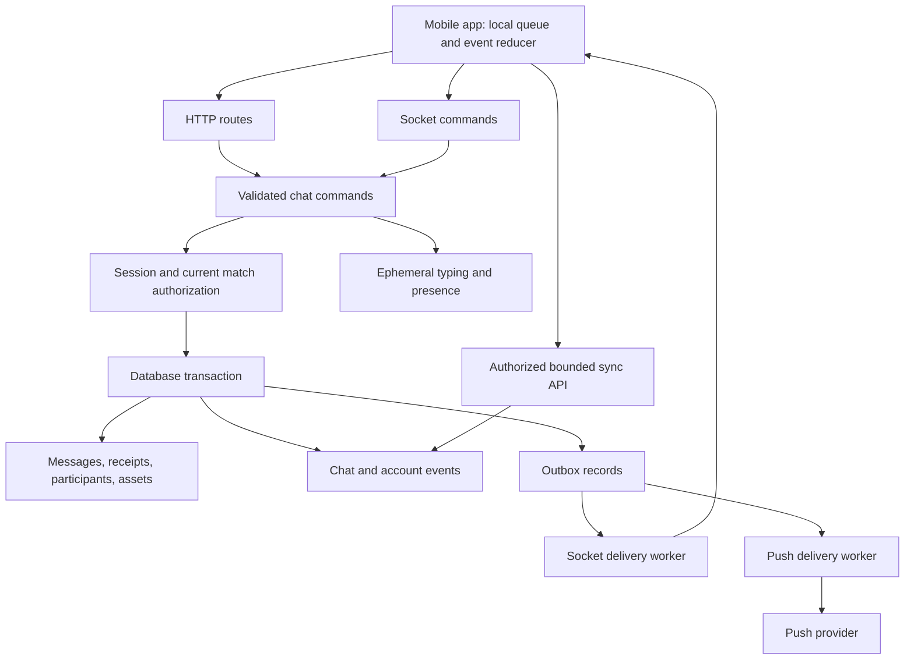
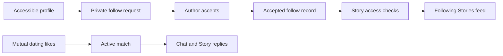

# Chat, Stories, and Search — reviewed build plan

Date: 2026-09-07.

Status: core implementation completed in the local workspace on 2026-09-07. The local Phase 7 release controls were added on 2026-09-08. See `chat-stories-search-implementation.md` for the implemented contract and `phase7-mobile-release-rehearsal.md` for the remaining signed-device and store gates.

## 1. Scope and product defaults

Complete the existing one-to-one match chat. Add Stories and replace the Search placeholder. Reuse the current authentication, membership, match access, media ownership, moderation, outbox, and discovery services.

Revised direction after the owner's clarification: add follower-based Stories and a dating Explore tab. Use private follow approval as the recommended launch policy:

- Chat remains available between active matches. A new search result or story view cannot create chat access.
- Stories are visible to approved followers. A dating match does not automatically create a follow. An approved follow does not create a match or chat permission. New approved followers can see still-active stories.
- The current Search tab becomes Explore: interest categories, dating intent, and filters over eligible profiles. Conversation and message search stay inside Chats.
- Stories appear in a horizontal tray above the Chats list. The owner opens the composer from “Your story.” They do not require a sixth bottom tab.
- No public user directory, anonymous message requests, group chat, voice/video calls, or live location in this package.
- Public stories, public comments, forwarding private attachments, and disappearing chat messages are not launch requirements.

Private follow mechanics are specified in section 5.8. Public college-wide Stories remain a separate optional extension. All numeric limits below are proposed starting limits. Validate them on devices and enforce them on the server.

## 2. Verified current state

| Area | Source evidence | Assessment |
|---|---|---|
| Message command | `apps/api/src/services/chat.service.ts`, `sendMessage` | HTTP and socket use the same service. Message, attachment transition, session update, and outbox record share a transaction. |
| Idempotency | Same service; Message sender/client ID uniqueness | Existing ID returns the original message. A retry with changed content in the same match is not rejected as a payload conflict. |
| Authorization | `match-access.service.ts`, `socket.ts`, chat routes | Active-match checks and per-event session checks exist. Shared validation and mutation-time race coverage still need work. |
| Reconnect | `socket.ts`; mobile `services/socket.ts`; `ChatScreen.tsx` | Server automatically joins active match rooms on each connection. Mobile connect handler retries queued sends but does not run catch-up sync. |
| Read state | `ChatScreen.tsx`, `handleMessagesRead` | Listener is a no-op. Received messages trigger two mark-read paths, including when the user is scrolled away. |
| Other devices | `ChatScreen.tsx`, `handleNewMessage` | All events from the current sender are ignored. A message sent on another device can be missing. Content-based optimistic reconciliation can confuse identical messages. |
| Edit/delete | `chat.service.ts`, `chat.controller.ts`, `chat.routes.ts` | Edit lacks the send schema and length enforcement. Delete-for-me broadcasts to the match room. Mutations lack durable replay. |
| History | `getMessages` | Incremental reads use `(sentAt,id)`. Older-page reads order by `sentAt` alone. The matching composite index is absent. |
| Conversations | `getConversations` | Fetches all active matches and sorts in memory. Unread counts use grouped reads. The API returns `isRead`, while a list bubble reads `readAt`. |
| Voice | `VoiceRecordBar.tsx`; ChatScreen voice upload | PCM recording configuration and a hardcoded `.m4a` upload disagree. Actual output must be checked on both platforms. |
| Media access | `chat-media.service.ts`; `MessageBubble.tsx` | Owned tickets and linked-message checks exist. GET URLs last 15 minutes; the mobile query can remain fresh for 30 minutes. HEAD metadata is not byte inspection. |
| Offline queue | `services/offlineQueue.ts` | Account-keyed AsyncStorage queue exists. Read-modify-write operations are not atomic. Temporary file lifetime and queue ownership during account switching need explicit handling. |
| Report action | `MessageBubble.tsx`, `handleReportMessage` | Shows a success alert without submitting a report. Existing report service accepts match context, not a validated message evidence reference. |
| Push | `outbox-delivery.service.ts`, `push.service.ts` | Notification records deduplicate. Provider sends can repeat on outbox retry. Push currently runs before the socket emission and contains message text. |
| Notification navigation | `RootNavigator.tsx`; `services/notifications.ts` | Push path and navigation path differ. Registration exists; no response listener was found in the inspected notification service. |
| Presence | ChatScreen header | “Online” describes the local socket connection, not the other user. |
| Search | `navigation/MainTabNavigator.tsx` | Search renders `DummyScreen`. Matches also renders `DummyScreen`; it needs a working destination before linking new features to it. |
| Stories | Search of mobile source, API source, and Prisma schema | No story implementation was found in this checkout. Treat the following design as new work. A design or implementation elsewhere is not evidence for this checkout. |

## 3. Corrections to the supplied chat plan

| ID | Finding | Required correction |
|---|---|---|
| CHAT-P01 | Reconnect diagnosis is partly inaccurate. | Keep explicit acknowledged joins for an open conversation, but fix missed-event recovery rather than claiming the server never rejoins rooms. Subscribe before requesting catch-up. |
| CHAT-P02 | Event persistence is assigned to two places. | Write the domain mutation, ChatEvent, account-list event, and outbox record in one database transaction. The delivery worker must not create the authoritative ChatEvent later. |
| CHAT-P03 | Typing is included in the durable event log. | Keep typing and online presence in Redis with expiry. Do not store each keystroke or heartbeat in PostgreSQL. |
| CHAT-P04 | Database deduplication is described as push deduplication. | Add delivery records per event, channel, and device. State the remaining provider retry ambiguity. Do not promise exactly-once push delivery. |
| CHAT-P05 | Push failure blocks socket delivery. | Deliver socket hints and push through separate retryable channel work. A push outage must not delay chat visibility. |
| CHAT-P06 | A delivered timestamp cannot express all receipt states. | Use server message order, per-message recipient receipts, participant summaries, and separate device sync cursors. Never use a client clock as a read boundary. |
| CHAT-P07 | Delete-for-me is treated as a room event. | Store its visibility change and notify only that user's devices. The other participant must retain the message and receive no private hide event. |
| CHAT-P08 | Sending validation is not equivalent on both transports. | Put runtime validation inside the shared command boundary. Reject malformed types, excess attachments, and overlong content. Trimming is not HTML sanitization; render plain text safely. |
| CHAT-P09 | Media checks trust uploader metadata. | Inspect bytes, pin the validated object version or promote it to an immutable key, and enforce processing limits before attachment. Prevent reuse of an upload URL to replace approved bytes. |
| CHAT-P10 | Media expiry is treated as access revocation. | Authorization stops new access grants. Already issued URLs remain usable until expiry unless delivery uses a revocable gateway. Already downloaded bytes cannot be recalled. |
| CHAT-P11 | `ILIKE` with a result limit is called index-friendly. | Design and measure the index. Use PostgreSQL text search or `pg_trgm` for supported patterns; scope every query by authorization first. |
| CHAT-P12 | Android maps are said to need no API key. | Expo Go setup is not store-binary setup. Configure the Google Maps project, restricted API key, signing fingerprints, and native build. |
| CHAT-P13 | One global read timestamp is called categorically invalid. | A recipient timestamp can describe a one-to-one read receipt. The actual gaps are visibility-based reads, multi-device recovery, monotonic updates, and unread accounting. |
| CHAT-P14 | General file and location support precede safety prerequisites. | Make these separately gated extensions. Inspect documents before download. Explain approximate location and enforce expiry in server payloads, caches, and events. |
| CHAT-P15 | Validation still says 63 tests. | Use the current 83-test baseline. Record new totals after implementation, not before tests exist. |

Socket.IO preserves event ordering but does not provide durable server replay by default. The current Redis Pub/Sub adapter does not supply connection-state recovery. Keep application-level replay. [Socket.IO delivery guarantees](https://socket.io/docs/v4/delivery-guarantees/), [Redis adapter](https://socket.io/docs/v4/redis-adapter/).

PostgreSQL trigram indexes can support `LIKE` and `ILIKE`; query shape and available trigrams determine usefulness. A small result limit alone does not establish efficient execution. [PostgreSQL 16 documentation](https://www.postgresql.org/docs/16/pgtrgm.html).

Google Maps deployment needs additional configuration and an API key. Rebuild and test the signed application after configuration changes. [Expo map documentation](https://docs.expo.dev/versions/latest/sdk/map-view/).

## 4. Target chat architecture

### 4.1 Service boundaries

Keep a modular API rather than adding separate microservices now.

PostgreSQL owns durable state. Redis stores presence, typing, rate limits, and transport coordination. Object storage contains private media. The outbox dispatches committed work. Mobile caches are replaceable projections, not authority.

### 4.2 Data model

| Record | Fields and constraints | Purpose |
|---|---|---|
| ChatSession | Existing unique match ID; add `lastMessageSeq`, `lastEventSeq`, and version | Allocate order while holding the conversation lock. Do not use unlocked `MAX(seq)+1`. |
| Message | Add `messageSeq`, `type`, typed/versioned metadata, `replyToId`, `editedAt`, `revision`, `deletedForEveryoneAt`, optional `expiresAt`, optional `storyId` | Unique `(matchId,messageSeq)`. Preserve unique `(senderId,clientMessageId)`. A server system message cannot be forged by a client. |
| ChatParticipant | Unique `(matchId,userId)`; read/delivery summary, unread count, mute, archive state | Account-level preferences and summaries shared across the user's devices. |
| MessageReceipt | Unique `(messageId,recipientId)`; first `deliveredAt`, first `readAt` | Exact one-to-one receipt for a message actually received or displayed. Read implies delivered. |
| ChatDeviceCursor | `(userId,deviceId,matchId)`; last applied event sequence | Tracks device replay. It does not prove that the person read the screen. Bind device IDs to authenticated sessions. |
| MessageReaction | Unique `(messageId,userId)`; allowed emoji; revision | One reaction per person. Set/remove commands are idempotent. |
| MessageVisibility | Unique `(messageId,userId)`; hidden timestamp | Replaces mutable `hiddenBy` arrays after compatible migration. Private hide state never reaches the other user. |
| ChatEvent | Unique `(matchId,eventSeq)`; event ID, type, actor, visibility scope, target IDs, revision, timestamp | Transactional replay of message creation, edits, deletion, reactions, and receipt changes. |
| AccountEvent | Unique `(userId,accountSeq)`; conversation update or access-revocation hint | Recovers chat-list updates and removal of rooms that can no longer be read. Include no revoked conversation content. |
| ChatMediaAsset | Existing ownership; add immutable object/version, detected type, dimensions, duration, processing status, thumbnail/waveform references | Approval and lifecycle state for each attachment. |
| DeliveryAttempt | Unique `(eventId,channel,deviceId)` or equivalent destination key; state, lease, attempts, provider ticket | Independent channel retries and receipt polling. |
| Safety evidence reference | Message/story ID, reporter authorization proof, captured content/version, restricted retention state | Durable reporting context without making moderation evidence available through chat APIs. |

Use discriminated schemas for metadata. Set limits for caption, filename, waveform samples, coordinates, dimensions, and attachment count. Reject unknown metadata fields. Derive size and content type on the server.

Add `(match_id,message_seq)` and `(match_id,event_seq)` indexes. During transition, add `(match_id,sent_at,id)` and order both history paths consistently. Add participant list indexes that support cursor pagination by last activity. Measure plans with realistic conversation sizes.

### 4.3 Message send and mutation rules

1. Authenticate the session and validate the command through the same schema for HTTP and sockets.
2. Require a client-generated idempotency key for new-version clients. Compare a normalized command fingerprint on retry. Return a conflict when the same key carries a different match, text, type, or attachment set.
3. Take the conversation lock. Use the same lock order for send, edit, delete, read, unmatch, and block effects. Recheck current access inside the transaction.
4. Validate reply and attachment references in the same conversation. Reject hidden, removed, expired, or unauthorized references. A reply cannot quote another match.
5. Allocate order, write the mutation, update participant summaries, create replay events, and enqueue independent delivery work in one transaction.
6. Return the committed message or mutation revision. The sender can display “sent” after this acknowledgement.
7. Retry delivery asynchronously. Clients deduplicate by event ID and merge by message ID and revision.

Replies store a reference, not an unrestricted permanent copy. If the referenced content becomes unavailable, return an unavailable quote. Reactions cannot restore deleted content. Text editing uses a proposed 15-minute window and an expected revision to reject stale edits.

Delete-for-everyone produces a tombstone. Remove content from normal history, search, reply previews, notifications, and event projections. Restrict media access immediately; storage cleanup follows retention rules. Moderation evidence is separate.

Delete-for-me changes only the actor's projection and unread count. It synchronizes to that actor's other devices. It does not broadcast a global deletion.

### 4.4 Recovery and local persistence

Use a single account-scoped ChatSyncCoordinator above individual screens. It owns connection state, event subscriptions, queue retries, and conversation-list updates.

On sign-in, foreground entry, and reconnect:

1. Obtain a current access token. Replace socket authentication through a controlled reconnect. Listen to reconnect-attempt events on the Socket.IO Manager where required.
2. Register listeners, then join the open conversation with an acknowledgement. Do not assume the initial room join has completed when the transport connects.
3. Read account events and recover the conversation list.
4. Fetch conversation events after the device cursor, in bounded pages. Include `nextCursor`, `hasMore`, and a server high-water mark.
5. Merge events by event ID and message revision. Merge own-device and other-device sends by `clientMessageId`, never by content.
6. Persist the applied cursor with the local message changes. Then acknowledge actual received messages and retry pending commands.

Event sequences can contain entries private to another participant. The server advances the scan cursor across authorized filtering without leaking private payloads. Do not require each client to receive every numeric sequence.

Retain a proposed 30-day replay window. If a cursor is older, return `SYNC_RESET_REQUIRED` and a bounded authorized snapshot with a new high-water mark. Snapshot and watermark must describe a consistent state. Preserve pending local commands during reset.

Use a transactional local store for the queue and message projection. Resolve the native storage library during implementation against the installed Expo version. Bind each task to its original account ID. Stop workers before account switch. Serialize queue changes, protect local data at rest, and exclude private caches from inappropriate backups.

Keep attachments in an app-owned draft directory until upload and send complete. Support ticket renewal, interrupted upload recovery, cancellation, storage quota, and terminal failure. A banned or unmatched conversation must stop retrying. A socket outage must not prevent an authorized HTTP fallback.

### 4.5 Delivery, read state, and unread count

- Queued means stored locally. Sent means committed by the API. Delivered means a recipient device acknowledged that message. Read means the app reported it visible in a focused foreground conversation.
- Do not mark every arriving message read while the app is backgrounded or the user is reading older messages. Use bounded visible-message acknowledgements and server timestamps.
- Keep receipts monotonic. Duplicate or out-of-order acknowledgements cannot clear a timestamp or decrement unread twice.
- Update unread counts transactionally on new message, first read, hide, and deletion. Maintain a reconciliation command and test its result against authoritative rows.
- A participant high-water cursor is a summary. Do not infer delivery of missing older messages from one later acknowledgement.
- If read-receipt privacy is disabled, update local unread state but do not disclose the read timestamp to the sender. Define this setting before release.

### 4.6 Media, presence, and notification behavior

Media pipeline: requested upload → uploaded source → inspecting → ready/rejected → attached → access revoked → deletion scheduled. Failed processing has bounded retries and a reviewable error state.

Proposed limits: ten attachments per message; images up to 15 MB before processing; voice up to 60 seconds and 10 MB; video up to 30 seconds and 50 MB. Files are a later gate, initially PDF/TXT up to 20 MB. Add DOC/DOCX only after inspection support exists. Enforce total-message and account upload quotas too.

Inspect actual voice output on Android and iOS. Use a supported codec/container or a validated transcode path. File extension, declared MIME, detected content, and playback format must agree. Keep waveform data bounded and derived from the actual recording. Generate private thumbnails from approved media.

Batch media access by asset IDs, maximum 20 per request. Verify each asset's linked message and current access. Return `expiresAt` with every grant. Refresh before expiry and after a single authentication-related fetch failure. Partition disk caches by account and clear inaccessible entries on revocation. Never use a cached signed URL as permission proof.

Presence is account-level aggregation over active device sessions in Redis. Proposed heartbeat 25 seconds and expiry 75 seconds. Show “online” only from server presence; otherwise show hidden/unknown or a coarse last-active value allowed by privacy settings. Typing expires after five seconds. Rate-limit both. Neither appears in the durable ChatEvent log.

Push defaults to a generic title and “New message.” A name in the title can also reveal a private contact. Require opt-in for detailed previews. Check mute, current access, and message availability immediately before delivery. Track individual provider tickets and receipts. Retrying a partially successful multi-device batch must not resend already completed destinations deliberately; an ambiguous provider timeout still prevents an exactly-once guarantee.

Process foreground, background, cold-start, and repeated notification taps with one typed link resolver. Queue an intended destination until authentication completes. Fetch conversation details by ID; do not trust names, participants, or access claims inside the notification.

### 4.7 Location and optional forwarding

Location is a separate, explicit attachment consent. Sharing a place must not change profile location. The proposed first version shares an approximate static point with a clear accuracy label and server-enforced one-hour expiry. Do not market a one-kilometre cell as a precise meeting pin. A later precise-place mode needs a separate user choice.

After expiry, history, search, replay, and map links return no coordinates. Cleanup removes coordinates from normal storage under the documented retention policy. Explain that a recipient may already have copied them. No live tracking.

Forwarding is optional. Do not reuse a private source object key in another match. If enabled later, authorize the source and destination, create a separate approved destination asset, preserve provenance for review, and define deletion behavior. Do not forward Stories or location cards in the first version.

The current server can read messages. This design does not claim end-to-end encryption. Adding end-to-end encryption would require a separate design for keys, multi-device recovery, reporting, attachments, and search.

## 5. Stories system

### 5.1 User flow

1. Open “Your story” above Chats. Choose an image or short video. Write an optional caption of up to 200 characters.
2. Show “Approved followers” before publication. Explain that accepting a follow request shares active Stories but does not enable chat.
3. Upload to a private quarantine area. Show processing status. Do not publish uninspected content.
4. After approval, set `publishedAt` and `expiresAt = publishedAt + 24 hours`. Processing time does not consume the story lifetime.
5. Display a story ring for authors with authorized active stories. Group by author, then play the author's items oldest first.
6. Pause on long press, app background, a report dialog, or media loading. Provide accessible previous/next controls and a close button.
7. Allow a private reply only when the viewer also has an active match with the author. Show the story reference in that chat. Followers without a match can view but cannot send a reply or open a chat.
8. Let the author delete the story and see a private viewer list. Let viewers mute the author or report the story.

Proposed limits: ten publishes per rolling 24 hours, ten active items, image source up to 10 MB, video source up to 30 MB and 30 seconds. Deleting an item does not reset the publish quota. Server configuration controls these limits.

### 5.2 Story records

| Record | Required fields and indexes |
|---|---|
| Story | ID, owner ID, client publish ID, asset ID, caption, audience, state, revision, published/expiry/deletion timestamps. Unique `(ownerId,clientPublishId)`. Index owner and live-feed time bounds. |
| StoryMediaAsset | Private source and approved rendition keys, owner, detected type, duration, dimensions, processing state, checksum/object version, cleanup state. Reuse the media pipeline implementation without reusing a profile-public URL. |
| StoryView | Unique `(storyId,viewerId)`; first visible time. Paginated owner-only viewer access. No counting downloads or prefetches as views. |
| Follow | Unique `(followerId,followeeId)`; pending/accepted/declined status, timestamps, cooldown, revision. Index `(followerId,status,followeeId)` and `(followeeId,status,createdAt,id)`. |
| StoryPreference | Unique `(viewerId,authorId)`; mute or story-hide policy. Story mute does not block chat. |
| Story reply reference | Optional story ID on a regular chat message. The reference renders as expired/unavailable after access ends. The reply text remains under chat rules. |
| Story moderation evidence | Restricted evidence capture linked to the report and case, outside the normal 24-hour view API. |

Public counters, follower graphs, popularity rankings, and a public viewer list are excluded.

### 5.3 Authorization matrix

| Action | Rule |
|---|---|
| Create or publish | Current adult student access, active account, owned inspected asset, quota available. |
| View feed or media | Owner, or accepted follower; current adult/student/account access and approved institution scope; no block; published and not expired/removed. |
| Record view | Same authorization as view. Deduplicate. Proposed trigger is one second of visible foreground display; document that this is not proof of attention. |
| List viewers | Author only, bounded pages. Omit identities no longer permitted by blocking policy. |
| Reply | Story view access and current active-match access, rechecked in the message transaction. |
| Delete | Owner; idempotent. Moderator removal uses a separately authorized audited action. |
| Report | Authenticated viewer with recent verifiable exposure. Support reporting after expiry through a time-bounded receipt without granting content access. |

Block, follower removal, account restriction, and membership expiry remove new story access at the API. Recommended unmatch behavior also revokes follows in both directions, so ending contact does not silently leave Story access. Accepted follows use explicit social consent, not continuing dating-preference compatibility; they expose a minimal Story author card, not unrestricted dating-profile access. Discovery pause leaves existing follower access unchanged unless the user also pauses Stories. State these separate controls in the UI.

### 5.4 Publication, expiry, and cleanup

Use `draft → processing → published → expired/deleted/removed`. Make publish and delete idempotent. A transaction locks the story and checks its current revision so a delayed processing job cannot republish a deleted item.

Every read checks `expiresAt` using server time. Expiry does not depend on a cleanup worker running on time. Grant media URLs for no longer than the remaining lifetime and a proposed 60-second access window. For stricter revocation, use an authenticated media gateway. Document the residual window and downloaded-copy limitation.

A periodic bounded cleanup worker removes expired normal media and stale uploads. Separate upload-ticket expiry, story expiry, and evidence retention. Review retention for expired media and views before launch; do not leave it undefined or promise instant deletion from backups. Reapply deletion records after restoration.

Emit durable publication/removal outbox events. Those events carry invalidation hints, not permanent media URLs. Current authorization determines recipients at delivery and fetch. A delayed notification cannot make an expired story visible.

### 5.5 Feed and mobile state

Start with unread authors first, then recent authorized publication. Use stable `(latestPublishedAt,ownerId)` cursors and a feed high-water mark. Keep the viewed state separate from the sorting cursor so viewing an item does not skip other authors while paging. Recheck access after candidate retrieval.

Use fan-out on read over accepted follow relationships. Batch author metadata and viewed state. Cache candidate IDs briefly by viewer and authorization version; apply final checks on each read. Do not cache one college-wide response and filter it only on the phone.

Prefetch at most the next two authorized items. Pause video in the background. Respect data-saving and reduced-motion settings. Expired media must not replay from the local cache after a failed refresh. Show processing, rejection, expiry, and empty states explicitly.

Story reactions, if added, are private idempotent actions. They must not create repeated chat messages on retries. Start with view-only for unmatched followers and replies for active matches.

### 5.6 Proposed Stories API

| Method and path | Result |
|---|---|
| `POST /stories/uploads` | Owned upload ticket with limits. |
| `POST /stories/uploads/:assetId/complete` | Inspection job and processing state. |
| `POST /stories` | Idempotent draft/publish request. |
| `GET /stories/feed?cursor=` | Authorized author groups and bounded cursor. |
| `GET /stories/:id` | Current metadata and access state. |
| `POST /stories/:id/media-access` | Short-lived authorized asset grant. |
| `POST /stories/:id/views` | Idempotent visible acknowledgement. |
| `GET /stories/:id/views?cursor=` | Owner-only viewer page. |
| `POST /stories/:id/replies` | Existing-chat command with client message ID. |
| `DELETE /stories/:id` | Immediate logical removal and cleanup job. |
| `PUT /stories/preferences/:authorId` | Private story mute setting. |
| `POST /safety/reports` | Extended schema accepting validated story evidence context. |

Use standard inaccessible responses for unknown, unauthorized, and removed stories. Do not reveal whether a blocked person has published.

### 5.7 Story safety and operating checks

No public comments or unrestricted links in the first release. Strip location metadata. Do not auto-tag rooms, hostels, class schedules, or exact locations. A Story caption cannot bypass text moderation.

Test publishing while blocking, reporting just before expiry, deletion while a worker processes media, expiry with a stopped cleanup worker, and authorization after a signed grant. Measure publish failures, inspection delay, expired-object backlog, reports, and reply outcomes. Do not silently use views as a desirability score in discovery.

### 5.8 Private follows — recommended design

Keep three separate user actions:

| Action | Meaning | Access granted |
|---|---|---|
| Dating Like | Express dating interest through the existing swipe command. | Mutual likes can create a match. |
| Follow request | Ask to receive someone's Stories. | No access until the author accepts. |
| Accepted follow | Author permits this follower to see active Stories. | Story view access; no chat permission. |

Button states: Follow → Requested → Following. “Requested” supports cancellation. “Following” supports unfollow and mute. Authors have a request inbox with Accept/Decline and a private follower-management screen with Remove/Block.

Expose Follow on a currently accessible dating profile or active-match profile. Do not add unrestricted person lookup to acquire followers. Require Stories opt-in and `allowFollowRequests`; show that setting during Story activation. New requests require current authorized profile access, adult/student checks, no block, and the selected institution scope. A recipient must be able to inspect a minimal requester card before acceptance.

Accept under a transaction that rechecks the request, account state, current blocks, and request eligibility. Use idempotency keys and relationship revisions. Decline sends no explanatory push to the requester. Use a proposed 30-day re-request cooldown after decline or removal; account-wide and per-target rate limits prevent repeated requests. Cancelling and resubmitting does not bypass cooldown or request quotas.

Block cancels pending requests and removes accepted follows in both directions. Unfollow removes access to the author's Stories. Remove follower revokes that follower's access. No action automatically unmatches except the existing explicit block/unmatch command. On unmatch, the recommended additional follow revocation happens in the same contact-ending workflow. Re-follow requires fresh consent.

Follower/following lists are owner-private at launch. Show no public follower count or popularity leaderboard. Follow counts and Story views do not alter dating ranking. Presence remains visible only through authorized match chat, not to followers.

Use the account-event stream for request inbox updates and relationship changes. Send generic, rate-limited request notifications. Do not broadcast a private follow event to all of a person's matches.

Proposed endpoints: `POST /follows/requests`, `DELETE /follows/requests/:id`, `POST /follows/requests/:id/accept`, `POST /follows/requests/:id/decline`, `DELETE /follows/:authorId`, `DELETE /followers/:followerId`, `GET /follows/requests?cursor=`, `GET /followers?cursor=`, and `GET /following?cursor=`. All list routes return only the authenticated account's relationships.

A future public or college-wide Story audience needs a separate consent, moderation, and privacy design. It is not enabled by following. Federation across colleges must use approved institution IDs rather than free-text college names.

## 6. Search tab

### 6.1 Product behavior

Replace `DummyScreen` with an Explore screen. Keep the existing internal Search route during migration; show Explore as its tab label.

The initial screen has an interest/topic search field, category tiles, dating-intent filters, and a link to saved discovery preferences. Example tiles are Music, Gaming, Coffee, Outdoor activities, and Long-term dating. Generate these from the real catalog and supported relationship intents. Do not invent event availability or infer sensitive traits.

A category opens an eligible profile deck or bounded card list. A card can open the profile, Like, Pass, or request a Story follow when enabled. Follow remains a secondary action; it must not replace the dating Like button.

A follow request immediately shows the sender's profile and request to the recipient. Require an explicit disclosure confirmation before the API accepts the request. A dating Like remains hidden until both users Like each other.

Filtered Explore requires at least 10 profiles in the complete eligible cohort. Stop the cohort query after the threshold. Do not return an exact cohort count. Accept at most two filter dimensions. A non-default category counts as one dimension. Apply the threshold again for every page request.

Keep conversation-name search in the Chats list and message search inside the chat header. A cross-conversation search screen can also be reached from Chats. The Explore tab must not mix private-message results with stranger profiles.

This follows the general dating-discovery pattern, not an exact copy of another app. Tinder documents interest-based Search, Bumble documents Discover using shared interests and dating goals, and Hinge documents a preference-based Discover feed. [Tinder Search](https://www.help.tinder.com/hc/en-gb/articles/46499067265037-Search), [Bumble Discover](https://support.bumble.com/hc/articles/28423668110621-Using-the-Discover-tab), [Hinge Discover](https://help.hinge.co/hc/en-us/articles/36311592824595-Discover-Feed).

Stories remain in the Chats tray initially. A later Story search must enforce Story access and expiry. Do not build a public archive of expired captions.

### 6.2 People search architecture

1. Validate and normalize supported filters. Use the shared interest catalog.
2. Require complete setup and verified adult membership. Load current saved preferences from the server.
3. Apply the same mutual eligibility, block, pass, match-exclusion, and account-state predicates as discovery. Search may narrow that set; it cannot widen it.
4. Retrieve a bounded candidate set with query-appropriate indexes. Apply stable ordering within a short-lived search session.
5. Recheck candidates before delivery. Return the same public profile contract as discovery.
6. Use the discovery exposure reservation and visibility receipt mechanism for displayed People cards. Search cannot provide unlimited exposure outside those controls.
7. Send likes and passes through the existing swipe command. Opening a result does not create chat access.

Do not silently modify saved preferences when applying a temporary search filter. Explain empty results and offer an explicit route to settings. Do not return exact total counts for arbitrary filter combinations.

Cache candidate IDs using viewer ID, query hash, institution scope, and eligibility/configuration versions. Invalidate on block, preference changes, pause, or restriction. Never serve cached public-profile fields without current access checks.

### 6.3 Conversation search architecture

Use PostgreSQL initially. Add indexed normalized search text or a `tsvector`, with a language configuration tested against expected English, Bengali, Hindi, and transliterated messages. Use trigram matching only for measured supported cases; exact names and short queries need a separate bounded strategy.

Every query scopes to accessible conversations and excludes messages hidden for that viewer, tombstones, removed content, and expired location metadata. Apply authorization before computing visible snippets or result counts. Recheck at result opening.

Edits update the search projection in the same transaction where possible. Deletes and blocks must suppress results immediately even if an asynchronous index lags. If an external search service is introduced later, final database authorization remains mandatory.

Escape wildcard semantics for literal substring search, parameterize values, bound query length, and cancel stale mobile requests. Proposed query length 2–100 characters, 300 ms debounce, 20 results per page, maximum 50. Rate-limit by account and server, not only by UI delay.

### 6.4 Proposed Search API

| Method and path | Rule |
|---|---|
| `GET /search/interests?q=` | Public catalog labels/IDs; no private profiles or popularity counts. |
| `POST /search/people` | Typed filters and bounded cursor; current discovery eligibility and exposure policy. |
| `GET /chat/conversations?q=&cursor=` | Only current user's accessible conversations. |
| `GET /chat/:matchId/search?q=&cursor=` | Match-scoped authorized message results. |
| `GET /chat/search?q=&cursor=` | Cross-conversation search within current access only. |
| `GET /chat/:matchId/messages/:messageId/context` | Bounded surrounding messages for a search result or reply jump. |

Keep event replay under `GET /chat/:matchId/events?afterSeq=`. Do not overload the history endpoint with incompatible history, replay, and text-search cursor meanings.

### 6.5 Search privacy and usability

Do not log raw private queries or message snippets in analytics. Record only timing, scope, result-count bucket, and failure class. Recent searches are optional, account-local, bounded, clearable, and removed on logout.

Provide recent interest choices, loading, no-result, offline, permission, and expired-result states. Announce updated result counts to accessibility services without moving keyboard focus. Do not search local private caches after access revocation.

## 7. Shared API and event contracts

Use versioned shared request and response schemas. Keep route controllers and socket handlers thin. A shared command returns the same error code and result through either transport.

Required chat endpoints include bounded conversation listing, history, event sync, send, edit with expected revision, private hide, delete-for-everyone, reaction set/remove, receipt acknowledgements, mute, media access, and context jump. Add an account-event endpoint for list recovery.

An event envelope contains `eventId`, `schemaVersion`, `matchId`, `eventSeq`, `type`, `entityId`, and `entityRevision`. Sensitive content is projected from current authorized state. Do not store permanent unredacted text copies in every event payload. Revocation events sent to account rooms contain only the ID to remove and a generic unavailable state.

Use consistent errors: `MATCH_UNAVAILABLE`, `MESSAGE_UNAVAILABLE`, `MESSAGE_ID_CONFLICT`, `REVISION_CONFLICT`, `MEDIA_PROCESSING`, `MEDIA_REJECTED`, `STORY_UNAVAILABLE`, `SYNC_RESET_REQUIRED`, and `RATE_LIMITED`. Do not expose provider stack traces.

## 8. Implementation sequence

| Phase | Package | Exit criteria |
|---|---|---|
| 0 | Characterization tests and current bug fixes | Reconnect recovers missed messages; own-device events merge; read status updates; no false report success; private delete stays private; preview and URL expiry bugs covered. |
| 1 | Chat data model and transactional events | Additive migration, deterministic history order, command validation, event/outbox atomicity, idempotency conflicts, and participant backfill verified. |
| 2 | Mobile sync coordinator and receipts | Two devices converge after offline send/edit/delete/reaction/read. Local pending state survives restart. HTTP fallback works during socket failure. |
| 3 | Media inspection and notification channels | Valid voice playback, approved assets only, thumbnail jobs, per-device delivery tracking, mute, private previews, and cold-start navigation pass. |
| 4 | Essential conversation UX | Replies, reactions, edit badge, tombstones, retry/progress, accessible controls, list pagination, and message reporting complete. |
| 5 | Private follows and Stories | Request/accept/remove/block rules pass. Follower-only publication, processing, feed, views, match-only replies, expiry, delete, report, and revocation pass. |
| 6 | Explore and chat search | Placeholder replaced by dating categories and filters. People preserves discovery rules. Separate conversation search and context navigation pass. |
| 7 | Optional extensions | Static approximate location, inspected files, or wider Stories only after their specific privacy and device checks. |
| 8 | Release evidence and owner deployment | Full suite, two-device drills, load/failure checks, migration rehearsal, documentation, and moderation readiness verified. |

Do not add group chats, calls, public-story reach, or an external search cluster as dependencies for the core release.

## 9. Migration and rollback

1. Inventory existing message formats, hidden/deleted state, duplicate client IDs, orphan media, and conversations. Record ambiguous formats for review rather than inferring solely from a suffix.
2. Add nullable fields and new tables. Keep old response fields while supported clients migrate.
3. Backfill message order using `(sentAt,id)` under a controlled high-water boundary. Use the same conversation lock or a short write barrier when switching sequence allocation. Do not renumber messages while new sends race.
4. Create both participant rows and reconcile unread counts from existing visibility/read state. Do not invent historical delivery timestamps or event history.
5. Establish an event baseline for legacy conversations. Old clients fetch a snapshot; they cannot replay mutations that were never recorded.
6. Add concurrent indexes separately and verify validity and query plans. Keep migration statements compatible with existing project practice.
7. Deploy additive readers, then new writers, then the mobile client. Set a minimum client version before retiring incompatible receipt or message formats.
8. Roll back feature visibility through flags if needed. Do not bypass authorization, re-expose removed media, or drop data tables as a rollback shortcut.

Stories and Search launch disabled until their gates pass. Reuse existing media worker patterns while preserving purpose-specific authorization. Update the runbook with final commands only after implementing them.

## 10. Verification matrix

| Area | Required evidence |
|---|---|
| Commands | Same validation on HTTP/socket; concurrent duplicate sends create one message/event; changed retry payload conflicts; attachment counts enforced. |
| Access | Third account denied on history, sync, search, reactions, receipt, batch media, story views, viewer lists, and reports. |
| Races | Block/send, unmatch/edit, delete/react, read/new send, hide/read, story publish/delete, story expiry/reply, follow accept/block, unfollow/view, and unmatch/follow revocation. |
| Replay | Duplicate/out-of-order hints, missing events, private event gaps, old cursor reset, two devices, own-sender events, and app restart. |
| Receipts | Offscreen/background messages stay unread; duplicate ack does not decrement twice; read implies delivery; privacy setting honored. |
| Media | Wrong bytes/MIME, source overwrite after inspection, expired ticket, processing crash, URL expiry, hidden asset, playback format, upload cancellation. |
| Push | Provider partial success, ambiguous timeout, duplicate work, revoked access, muted conversation, private lock screen, repeated tap, all app states. |
| Stories | Pending media never public; expiry works with worker stopped; block/unmatch/follower removal hides; rejected requests grant no access; unmatched followers cannot reply; prefetch is not a view; owner-only viewer list; replay cannot restore removed story. |
| Search | Same eligibility as discovery; no email/phone lookup; expired/hidden content absent; stale cursor and old response ignored; injection/wildcards handled; queries absent from logs. |
| Lifecycle | Logout/account switch clears private state; deletion covers new tables/objects; restricted evidence retained only by documented policy; backup deletion replay. |
| Device | Two physical devices; reconnect, microphone interruptions, low storage, denied permissions, large text, screen reader, foreground/background, and signed-build links. |
| Load | Long conversation history and replay with bounded pages; many conversations; concurrent sends; story media processing; scoped search plans; PostgreSQL/Redis/push/storage outages. |

Track command commit latency separately from delivery latency. Track sync lag, replay resets, unread reconciliation mismatches, queue failures, inspection backlog, expired-object backlog, and search latency. Do not use a passing small fixture as production-capacity evidence.

## 11. First implementation package

Start with CHAT-P01, CHAT-P04 through CHAT-P09, and the own-sender/read-state bugs. Add their regression tests before expanding message types. Fix the Search and Matches placeholders only when their real screens and destinations exist; do not replace them with fabricated content.

This plan adds Stories and Search to the app roadmap. It does not mark the chat, Stories, Search, store release, or wider app safety backlog complete.
